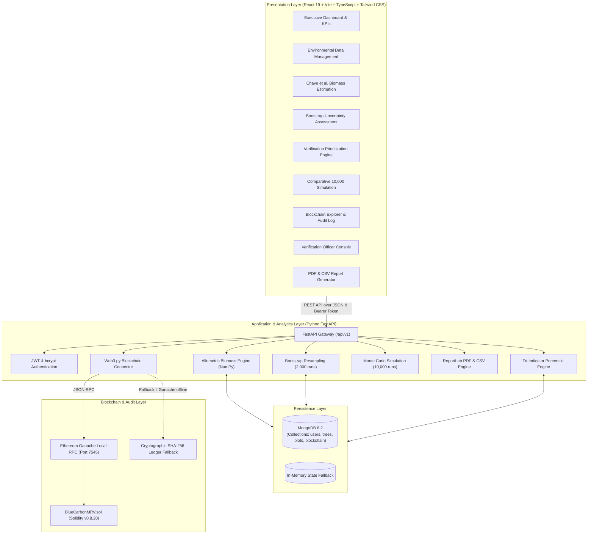

# System Architecture & Technical Design

**Project**: An Uncertainty-Aware Verification Prioritization Framework for Blockchain-Based Blue Carbon MRV Systems  
**Domain**: Coastal Blue Carbon Ecology • MRV Systems • Applied Data Science • Distributed Ledger Technology

---

## 1. High-Level Architecture Overview

---

## 2. Key Modules & Technology Stack

| Layer | Technologies | Responsibilities |
|---|---|---|
| **Frontend** | React 19, TypeScript, Vite, Tailwind CSS, Recharts, Lucide Icons | Responsive UI/UX, charts, interactive modals, role switching, dark/light themes |
| **Backend** | Python 3.14, FastAPI, Uvicorn, Pydantic v2 | High-throughput async REST endpoints, scientific computations, data validation |
| **Data Science** | NumPy, Pandas, SciPy, Scikit-learn | Chave et al. (2014) equation vectorization, 2,000 bootstrap runs, percentile rankings, 10,000 Monte Carlo runs |
| **Database** | MongoDB 8.2 (Motor async + PyMongo sync) | Persistent storage for 2,249 tree measurements, 118 plots, audit logs, and user credentials |
| **Blockchain** | Solidity 0.8.20, Web3.py, Ganache / Cryptographic SHA-256 | Immutability, tamper-evidence, verification officer sign-offs, evidence hashing |
| **Reporting** | ReportLab, RFC 4180 CSV | Generates printable landscape executive audit certificates and structured CSV data |

---

## 3. Data Processing & Verification Pipeline

1. **Ingestion & Dendrometry**: Field mangrove tree measurements (tree ID, plot ID, species, DBH, height, wood density, GPS coordinates) are uploaded via CSV or entered manually.
2. **Missing Data Imputation & Cleaning**: Automated detection of missing fields, imputation using species-specific medians, and duplicate removal.
3. **Allometric Calculation**: Execution of Chave et al. (2014) formula to calculate tree-level and plot-level Aboveground Biomass (AGB).
4. **Uncertainty Quantification**: 2,000 non-parametric bootstrap resampling iterations per plot to establish 95% Confidence Intervals [$CI_{\text{lower}}, CI_{\text{upper}}$] and relative uncertainty percentages.
5. **Sensitivity Analysis**: Perturbation of wood density by $\pm 10\%$ and $\pm 20\%$ to test model robustness.
6. **Composite Prioritization**: Percentile normalization of (1) Relative Uncertainty, (2) Data Quality Concerns, and (3) Estimated Biomass Impact. Plots ranked and stratified into High, Medium, and Low tiers.
7. **Comparative Strategy Simulation**: Evaluation of audit capture efficiency against uncertainty-only, systematic, and random sampling over 10,000 Monte Carlo runs.
8. **Blockchain Audit Trail**: Cryptographic SHA-256 evidence hashing and immutable recording of plot metrics and verification officer determinations on the distributed ledger.
